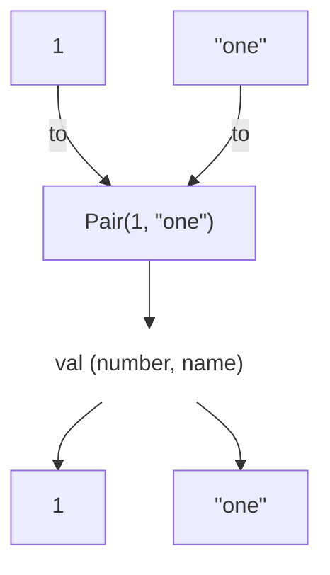

# What chapter in 'Kotlin in Action'?
- Chapter 3.4.3 Working with pairs: Infix calls and destructuring declarations (2/e version)

# What did I look?
- An `infix` modifier: you can make a function which can be invoked by *infix call*.
- The `to` function: you can make a pair of elements.

# Codes
## Creating a map with an *infix call*
```kotlin
fun main() {
    // create a map
    val map = mapOf(1 to "one", 7 to "seven", 53 to "fifty-three")
    println(map)
    // {1=one, 7=seven, 53=fifty-three}
}
```
- Note that `to` is not a built-in construct but a method (extension function).
  - It's called an *infix call*
- The simplified signature of `to` function looks like this:
    ```kotlin
    infix fun Any.to(other: Any) = Pair(this, other)
    ```
    - **Please pay attention to the `infix` modifier!**
    - Thanks to this modifier, you can invoke this function using an infix notation.

## Infix call vs. regular invocation
For instance, the following invocations are equivalent:
```kotlin
1.to("one")     // the regular way
1 to "one"      // infix call
```
- In an infix call, you have to put the method name `to` between two objects.
- As you can see in the above code (i.e., the simplified signature of `to`), `to` returns a pair of elements.

# A *destructuring declaration*
## A basic example
You can initialize two variables with elements of a `Pair`.
```kotlin
fun main() {
    val (number, name) = 1 to "one"
    println("$number, $name")
    // 1, one
}
```
- You can call this feature a *destructuring declaration*.
    - `1 to "one"` makes a `Pair`.
    - Right after that, `number` and `name` get the value `1` and `"one"`, respectively.



## Applying it to loops
You can utilize a *destructuring declaration*, when using `for` loop.
```kotlin
for ((index, element) in collection.withIndex()) {
    println("$index: $element")
}
```
- If collection is `listOf("A", "B", "C")`,
  - 1st iter &rarr; `index == 0` and `element == "A"`
  - 2nd iter &rarr; `index == 1` and `element == "B"`
  - 3rd iter &rarr; `index == 2` and `element == "C"`

# Note
- *Infix calls* can be used when you invoke regular methods or extension functions.
- If you want to attach a `infix` modifier to a method declaration, the method must have just a single parameter.
  - The function `to` also has exactly one parameter.
