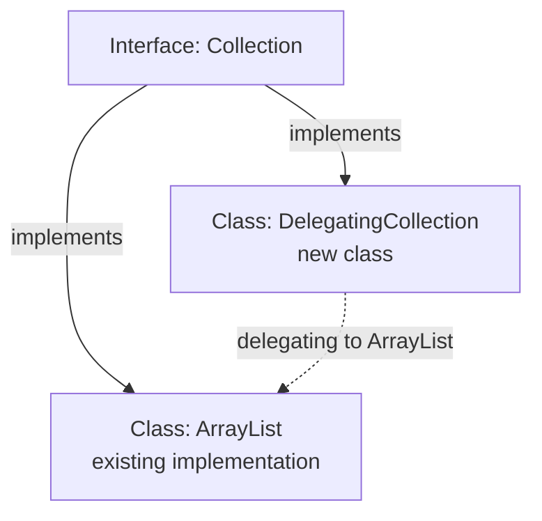

# What chapter in 'Kotlin in Action'?
- Chapter 4.3.3 Class delegation: Using the by keyword (2/e version)

# What did I look?
- What is class delegation?
- The traditional approach for class delegation: *decorator* design pattern
  - It entails a lot of boilerplate code.
- The `by` keyword for class delegation
  - It helps you to avoid the source code cluttered with boilerplate.

# Introduction: Class delegation
**_Class delegation_** is useful when a class wants to implement an interface but reuse the implementation of another object that already implements the same interface.
- Especially when the another object (i.e., class) is `final` and cannot be subclassed.
- Or when simply subclassing is improper.

## An example of class delegation
For example, `DelegatingCollection<T>` implements `Collection<T>`.  
However, instead of implementing all collection operations from scratch, it forwards them to another collection object such as an `ArrayList<T>`.  



## A traditional way: Decorator design pattern
Let's say that a class `DelegatingCollection<T>` implements an interface `Collection<T>`.  
- A property to be implemented: `size`
- Member functions to be implemented: `isEmpty`, `contains`, `iterator`, and `containsAll`

Then, another class `arrayListOf<T>` already implements this interface, and you want for `DelegatingCollection<T>` to reuse the implementations in `arrayListOf<T>` as they are, without adding new methods and modifying existing methods.  
In this situation, you can say that you are delegating the implementation of the interface (i.e., `Collection<T>`) to another object (i.e., `arrayListOf<T>`).  
- This is _**class delegation**_!  

To do class delegation, you can come up with a traditional way: *decorator design pattern*:
```kotlin
class DelegatingCollection<T> : Collection<T> {
    private val innerList = arrayListOf<T>()

    override val size: Int get() = innerList.size
    override fun isEmpty(): Boolean = innerList.isEmpty()
    override fun contains(element: T): Boolean = innerList.contains(element)
    override fun iterator(): Iterator<T> = innerList.iterator()
    override fun containsAll(elements: Collection<T>): Boolean = innerList.containsAll(elements)
}
```
- A decorator (i.e., the class `DelegatingCollection<T>`) usually implements the same interface (i.e., `Collection<T>`) as the wrapped object (i.e., the instance `innerList` of the class `arrayListOf<T>`).  
- The decorator delegates most calls to that object, while optionally changing or extending selected behavior.

### The drawback of manual delegation
Manual delegation such as **decorator pattern** entail a lot of repetitive forwarding code.  
On a side note, in practice, the boilerplate can become so large that many IDEs provide special features to generate it automatically.

## A solution in Kotlin: `by` keyword
Kotlin neatly solves the drawback of manual delegation with the `by` keyword.  

**Note that:**
> Class delegation with `by` keyword is a compiler-supported way to avoid manual forwarding boilerplate.  
> When a class implements an interface using `by`, the compiler generates implementations for the interface members that are not explicitly overridden in the class.  
> Those generated implementations forward calls to the delegate object.  
> Thus, you can avoid the source code cluttered with boilerplate.


# Codes
## Class delegation with the `by` keyword (1)
```kotlin
class DelegatingCollection<T>(
    innerList: Collection<T> = mutableListOf<T>()
) : Collection<T> by innerList
```
This class implements an interface `Collection<T>` but delegates the implementation to `mutableListOf<T>`.
- `mutableListOf<T>` implements the interface `Collection<T>`.
- A new class `DelegatingCollection<T>` attempts to implement **the same interface.**  
- However, `DelegatingCollection<T>` does not implement (i.e., override) the interface directly but use the implementation in `mutableListOf<T>` through an instance `innerList`.

## Class delegation with the `by` keyword (2)
```kotlin
// The class CountingSet<T> delegates almost all of the implementation to hashSetOf<T>.
// Exceptionally, CountingSet<T> directly overrides (i.e., implements) the two methods: `add` and `addAll`.
class CountingSet<T>(
    private val innerSet: MutableCollection<T> = hashSetOf<T>()     // the container which you are wrapping
) : MutableCollection<T> by innerSet {

    var objectsAdded = 0

    override fun add(element: T): Boolean {
        objectsAdded++
        return innerSet.add(element)
    }

    override fun addAll(elements: Collection<T>): Boolean {
        objectsAdded += elements.size
        return innerSet.addAll(elements)
    }
}

fun main() {
    val cset = CountingSet<Int>()
    cset.addAll(listOf(1, 1, 2))
    println("Added ${cset.objectsAdded} objects, ${cset.size} uniques.")
    // Added 3 objects, 2 uniques.
}
```
In this case, the class `CountingSet<T>` delegates almost all of the implementation to `hashSetOf<T>`.  
Exceptionally, `CountingSet<T>` directly overrides (i.e., implements) the two member functions: `add` and `addAll`, rather than delegating them.

---

# Note: Caution
Class delegation with `by` works for interfaces, not for delegating the implementation of a superclass.  
That is, when it comes to a class inheriting from a superclass, you cannot utilize `by`.

For example, it is impossible that:
```kotlin
open class Base {
    open fun print() {
        println("base")
    }
}

class Derived1 : Base() {
    override fun print() {
        println("derived1")
    }
}

class Derived2(
    private val base: Base = Derived1()
) : Base() by base // impossible
```

In this case, you can consider the manual forwarding.
```kotlin
open class Base {
    open fun print() {
        println("base")
    }
}

// final by default
class Derived1 : Base() {
    override fun print() {
        println("derived1")
    }
}

class Derived2(
    private val base: Base = Derived1()
) : Base() {
    override fun print() {
        base.print()
    }
}
```
